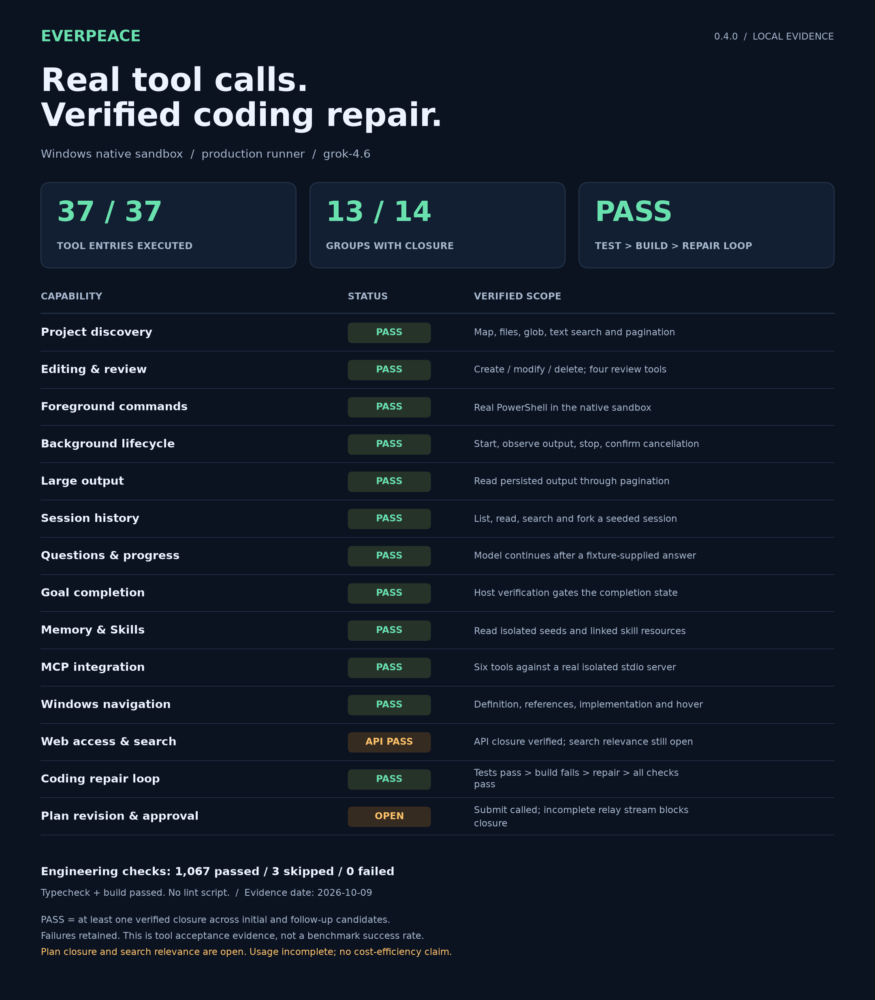

# Everpeace

**在终端中规划、修改并验证你的 Node.js / TypeScript 项目。**

[English](README.md) · [使用指南](docs/USAGE.zh-CN.md) · [实测展示](#真实调用验证改动) · [开发文档](docs/README.md)

[](https://github.com/VinceTree/Everpeace/actions/workflows/test.yml)
[](LICENSE)

Everpeace 是 DeepSeek 优先、Windows 优先的个人 Node.js / TypeScript 开发 CLI。单个 Agent 读取项目规则、搜索代码、提出计划、修改文件，再运行项目声明的检查。你可以在 inline 终端中交互，通过 `everpeace exec` 自动执行任务，或从 TypeScript 调用同一 runner。

先审阅计划和改动，再由宿主检查结果：重新发现 `typecheck → lint → test → build`，按顺序执行存在的检查，首败停止，最多进行三轮修复。缺少检查、证据过期、取消和用量不完整都会明确保留。

## 开始使用

准备 **Node.js 22+**、Git 和 **pnpm 10.22.0**。从仓库安装以应用 Windows `node-pty` 补丁；保留 optional dependencies，以使用随包代码搜索。

```powershell
git clone https://github.com/VinceTree/Everpeace.git
cd Everpeace
pnpm install --frozen-lockfile
pnpm dev
```

启动后输入 `/login`，选择 DeepSeek，输入遮罩显示的 API Key，再选择服务返回的原始模型 ID。也支持 OpenAI 和自定义 HTTPS Responses 端点，能力按实际端点识别。密钥保存在系统凭据库，不写入项目或 Session。

模型连接支持 `HTTP_PROXY`、`HTTPS_PROXY` 与 `NO_PROXY`，同名小写变量优先。端点需要代理时，在启动 CLI 前设置；仅设置 `ALL_PROXY` 不生效。这些设置作用于模型请求，模型 shell 仍遵守 sandbox 网络策略。

中转明确支持 DeepSeek Responses 契约时，可设置 `/model profile deepseek`，再设置 `/reasoning high`。`/status` 显示协议配置、能力来源和实际发送的推理值。这属于用户配置，不能证明中转兼容；未知端点默认采用保守设置，`/model profile auto` 恢复按地址识别。完整推理项在工具轮次之间保留。实验性的提示与工具反馈优化默认关闭，须先通过任务质量与实际 token 用量对比。

网页读取保留有界的来源链接列表，搜索结果宽泛时，Agent 可以沿官方网站的实际导航继续读取并核验引用。

```text
/login
/plan
解释请求预算的执行路径，并提出一个聚焦的回归修复计划。
```

审阅或修订计划，批准后显式开始执行。`/diff` 审阅改动，`/status` 查看请求设置和用量，`/resume` 恢复 Session。`/doctor` 进行本地诊断；`/doctor --live` 会发起模型请求，可能产生费用。宿主 TUI 界面使用英文。

使用构建后的 CLI：

```powershell
pnpm build
pnpm link --global
everpeace
```

当前源码版本：**0.4.0**。

## 真实调用，验证改动



[查看完整尺寸图表](assets/features.webp)。

这组隔离 Windows 场景通过中转的 `grok-4.6`，使用生产 runner 与原生 sandbox。**PASS 表示同一实测源码与构建的两个独立阶段中，每组至少取得一次闭环证据。** 包含 Plan 修订审批与基于实际来源的网页问答。首阶段因未知用量停止，失败和跳过项继续保留在本地。这不是整轮成功率、DeepSeek 实测结果或成本对比。

根到目标目录的规则、`@` 文件附件和按需项目地图帮助 Agent 理解代码。编辑基于当前文件观察，提供绑定权限的预览和拒绝并发覆盖的 undo。Session、fork 和上下文检查点在恢复时保留工作与验证债务。

配置 MCP 的工具、资源和 prompts，以及本地 Skills，可以扩展 Agent。Learned Memory 保存偏好与经过验证的经验；公共网页访问检查重定向与网络边界。搜索的首选服务不可用时，会依次尝试中国区 Bing 和 DuckDuckGo。配置和完整限制见 [使用指南](docs/USAGE.zh-CN.md)。

## 自动执行同一工作流

```powershell
everpeace exec "修复失败测试并运行项目检查" -C C:\projects\my-app --model deepseek-flash --token-budget 100000 --json
```

`exec` 与终端共用权限、工具、Session 存储、验证和清理，遇到需要用户交互的步骤会停止。`--plan` 只分析，不实施；`--resume <session-id>` 在新 fork 中继续。JSONL 消费者需要同时检查最终事件和进程退出码，包括取消及输出管道故障。

```typescript
import { runTask } from 'everpeace/sdk';

const result = await runTask({
  prompt: '修复失败测试并运行项目检查',
  workspacePath: 'C:/projects/my-app',
  model: 'deepseek-flash',
  tokenBudget: 100_000,
});
console.log(result.classification);
```

SDK 使用已注册凭据，不在任务参数中接收 API Key。[完整选项、事件与退出码](docs/USAGE.zh-CN.md#非交互执行)。

## 控制与边界

- 模型 shell 在固定原生 sandbox 中执行，Windows 通过 MXC 运行 PowerShell。sandbox 或 LSP 网络探针失败会阻止启动。可选语言服务器需事先安装并显式配置。
- 文件更新需要当前观察版本；审批和 undo 不覆盖用户后续修改。恢复 Session 保留工作，新的动作仍受当前权限约束。
- `Ctrl+C` 取消活动任务并等待清理；空闲时先清草稿，再退出。用户直接输入的 `!` 命令在独立宿主 PTY 中运行，独占终端输入，不进入模型上下文。
- 请求预算包含重试、压缩与修复。未知用量会阻止有界任务继续请求，推理 token 是输出 token 的组成部分。token 预算不是严格账单上限。
  请求失败且用量未知时保留安全 HTTP 状态和错误类别，不记录供应商错误正文或请求头。

审批按键、终端操作和集成配置见 [使用指南](docs/USAGE.zh-CN.md)。更广泛的编码质量、稳定性和成本仍须通过实测衡量。[开发状态](docs/HANDOFF.md) · [DeepSeek 实测准备](docs/benchmark/READINESS.md)。

## 开发与贡献

```powershell
pnpm typecheck
pnpm test
pnpm build
```

当前没有 lint script。开发从 [AGENTS.md](AGENTS.md) 和 [文档地图](docs/README.md) 开始。可复现问题请提交到 [GitHub Issues](https://github.com/VinceTree/Everpeace/issues)。

采用 [Apache 2.0](LICENSE) 许可证，由 [VinceTree](https://github.com/VinceTree) 维护。
